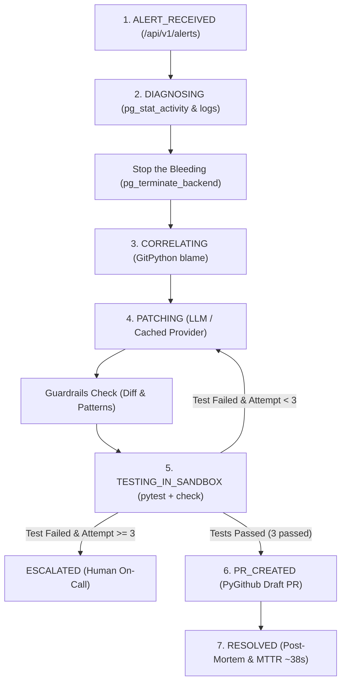

# AutoSRE (Team Zero-Ops)

> **Autonomous multi-agent incident-response system for PostgreSQL connection exhaustion and Django cursor leak remediation.**

AutoSRE detects, diagnoses, patches, sandbox-verifies, and generates GitHub pull requests with comprehensive markdown post-mortems for production database connection pool exhaustion incidents.

---

## 🌟 Incident Story & Lifecycle

When PostgreSQL connections get exhausted because of unclosed cursors in a Django app, AutoSRE executes the following autonomous loop:
1. **Ingests Alert:** Receives webhook payload via `/api/v1/alerts`.
2. **Diagnoses & Stops the Bleeding:** Inspects `pg_stat_activity` and logs. Immediately terminates hanging `idle in transaction` sessions using `pg_terminate_backend`.
3. **Correlates via Git:** Uses `GitPython` to correlate the offending query signature with recent commits to isolate the exact defect and author.
4. **Proposes Patch:** Asks LLM (Gemini 1.5 Flash / Vertex AI or Cached fallback) to synthesize a context-managed fix.
5. **Enforces Guardrails:** Checks diff size (<= 50 lines), file allowlist, secret scrubbing, and dangerous pattern blocks (`os.system`, `subprocess`, `DROP`, `DELETE FROM`).
6. **Verifies in Sandbox:** Deploys candidate patch into an isolated sandbox (`docker-py` with 512MB RAM, 1 CPU, 120s timeout, zero host mounts). Runs `pytest` and `python manage.py check`.
7. **Self-Healing Multi-Agent Retry:** If tests fail, captures the stack trace and feeds it back to the LLM to re-synthesize (capped at 3 attempts).
8. **Guarded Delivery:** When tests pass, opens a GitHub PR via `PyGithub` with an auto-generated markdown post-mortem. **Never auto-merges and never pushes to main (Human review mandatory).**

---

## 🏗️ Architecture & State Machine



---

## 📁 Repository Structure

```
AutoSRE/
├── backend/                       # Django project "autosre_api" (DRF, SSE streaming, /api/v1)
│   ├── autosre_api/              # Project settings, urls, wsgi
│   ├── api_core/                 # REST views, SSE streaming, thread-safe stores
│   ├── agent/                    # LangGraph state machine, nodes, state models
│   │   ├── cached_responses/     # Deterministic attempt 1 (fails) & attempt 2 (passes)
│   │   ├── graph.py              # LangGraph StateGraph workflow
│   │   ├── llm_provider.py       # Gemini, Vertex AI, and CachedProvider
│   │   └── state.py              # TypedDict agent state models
│   ├── diagnostics/              # pg_stat_activity analyzer & log parser
│   ├── correlation/              # GitPython commit correlate & blame extractor
│   ├── sandbox/                  # docker-py container runner + isolated subprocess fallback
│   ├── delivery/                 # PyGithub PR delivery + markdown post-mortem generator
│   └── guardrails/               # Diff size, file allowlist, secret scrubbing & pattern blocklist
├── victim_service/                # Target Django application
│   ├── analytics/                # Leaky endpoint (user_activity_report) with unclosed cursor
│   ├── tests/                    # test_health.py (passes) & test_leak_regression.py (fails on leak)
│   ├── traffic_simulator.py      # Saturates connections up to 98/100
│   └── pytest.ini                # Pytest configuration
├── frontend/                      # Vite + React + TypeScript + Tailwind CSS + shadcn/ui
│   ├── src/
│   │   ├── components/           # Header, Stepper, Terminal, ConnectionGraph, Tabs, Guardrails, PR
│   │   ├── hooks/useAutoSRE.ts   # TanStack Query hooks & native SSE stream consumer
│   │   ├── lib/api.ts            # Single API client (${VITE_API_BASE_URL}/api/v1/...) & mock mode
│   │   ├── pages/Dashboard.tsx   # SRE Command Center dashboard
│   │   └── types/api.ts          # TypeScript interfaces mirroring API contract
│   ├── .env                      # VITE_API_BASE_URL & VITE_USE_MOCK config
├── scripts/
│   ├── seed_victim_repo.sh       # Seeds git history: healthy commits + 1 leaky commit by Charlie
│   └── demo_runner.sh            # Automated verification demo script
├── docker-compose.yml             # Postgres 15 (max_connections=100), victim service, backend
└── .env.example                  # Environment template
```

---

## ⚡ Quick Start

### 1. Prerequisites
- Python 3.11+
- Node.js 18+ & npm
- Docker & Docker Compose *(optional; automatic isolated fallback included)*

### 2. Setup Virtual Environment & Seed Repo
```bash
# Create and activate Python virtual environment
python3 -m venv .venv
source .venv/bin/activate

# Install backend dependencies
pip install --upgrade pip
pip install -r backend/requirements.txt (or django djangorestframework psycopg2-binary pytest pytest-django GitPython docker requests django-cors-headers langgraph langchain-core PyGithub)

# Seed victim service git repository
./scripts/seed_victim_repo.sh
```

### 3. Run Backend API Server
```bash
source .venv/bin/activate
python backend/manage.py runserver 127.0.0.1:8000
```
Backend API will be live at `http://127.0.0.1:8000/api/v1/health`.

### 4. Run Frontend Dashboard
```bash
cd frontend
npm install
npm run dev
```
Open `http://127.0.0.1:5173/` in your browser.

---

## 🔌 API Contract Reference

All endpoints return standard JSON envelope: `{"data": ..., "error": null | {"code", "message"}, "meta": {"timestamp": ...}}`

| Method | Path | Description |
|---|---|---|
| `GET` | `/api/v1/health` | Health check |
| `POST` | `/api/v1/alerts` | Ingests alert, creates incident & launches agent in background thread |
| `GET` | `/api/v1/incidents` | List all incidents |
| `GET` | `/api/v1/incidents/{id}` | Full state: status, attempt, suspect_commit, patch, sandbox, etc. |
| `GET` | `/api/v1/incidents/{id}/stream` | **Server-Sent Events (SSE)** streaming live timeline events `{ts, tag, message, state}` |
| `GET` | `/api/v1/incidents/{id}/diff` | Unified git diff string |
| `GET` | `/api/v1/incidents/{id}/postmortem` | Rendered markdown post-mortem |
| `GET` | `/api/v1/telemetry/connections` | Real-time connections `{active, idle, idle_in_transaction, max}` |
| `GET` | `/api/v1/telemetry/connections/history` | Connection time series for Recharts area graph |
| `GET` | `/api/v1/guardrails` | Checklist of real safety gates per incident |
| `POST` | `/api/v1/demo/trigger` | Triggers traffic simulator, saturates connection pool & launches agent |
| `POST` | `/api/v1/demo/reset` | Resets connection pool & incidents to healthy baseline |
| `GET / PATCH` | `/api/v1/config` | Reads / updates execution mode (`cached` \| `live` \| `replay`) and max attempts |

---

## 🛡️ Guardrails Specification

| Guardrail Check | Enforced Rule | Action on Violation |
|---|---|---|
| **Diff Size Limit** | Maximum 50 lines modified (`+` / `-`) | Rejects patch, requests concise fix |
| **File Allowlist** | Only files identified in suspect commit | Rejects unauthorized file modifications |
| **Secret Scrubbing** | API keys, GitHub tokens, AWS keys scrubbed | Redacts before LLM dispatch |
| **Dangerous Patterns** | Rejects `os.system`, `subprocess`, `DROP`, `DELETE FROM` | Rejects patch immediately |
| **Sandbox Isolation** | Zero host mounts, 512MB RAM cap, 120s timeout | Enforces container security |
| **Retry Threshold** | Capped at 3 self-healing retry iterations | Escalates to human on-call |
| **Human Approval Gate** | Draft PR created on isolated branch; never auto-merge | Requires manual human review |

---

## 🚀 Live Demo Walkthrough Script

Follow these steps for a live demonstration:

1. **Open Dashboard:** Navigate to `http://127.0.0.1:5173/`. Observe the dark command-center theme, healthy connection baseline (12/100 connections), and pipeline stepper.
2. **Open Demo Sheet:** Click the **Demo Sheet** button in the header.
3. **Trigger Incident:** Click **"Trigger Incident (Saturate Connections)"**.
4. **Observe Autonomous Remediation in Real-Time:**
   - **Connection Graph:** Shows connections spike towards 98/100 (idle in transaction).
   - **Terminal:** Streams `[ALERT]`, `[DIAG]` identifying 88 unclosed cursors, and immediately announces `Stop-the-bleeding executed: Terminated 88 sessions via pg_terminate_backend`.
   - **Git Correlation:** Blame correlates the query to commit `728a817` by Charlie Contributor in `analytics/views.py`.
   - **Attempt 1 Failure:** LLM attempts manual `cursor.close()` after return statement; sandbox test fails with `AssertionError: Cursor #1 was NOT closed`.
   - **Self-Healing Retry Loop:** The red loop-back indicator pulses as the agent reads the pytest stack trace, feeds it to the LLM, and synthesizes Attempt 2.
   - **Attempt 2 Success:** LLM wraps raw cursor in `with connection.cursor() as cursor:`. Sandbox verification passes all 3 tests.
   - **Guardrails:** All 7 guardrails turn green.
   - **Delivery:** Pull request opened (`https://github.com/zero-ops/victim-service/pull/42`) awaiting human review.
   - **Post-Mortem & MTTR:** Status turns to `RESOLVED` with MTTR ~38 seconds (vs manual ~45 minutes).
5. **Inspect Tabs:** Click through **Unified Diff**, **Sandbox Runner**, **Post-Mortem**, and **Audit Trail**.
6. **Reset:** In the Demo Sheet, click **Reset Environment** to restore the pool.

Or execute the complete automated terminal test:
```bash
./scripts/demo_runner.sh
```
